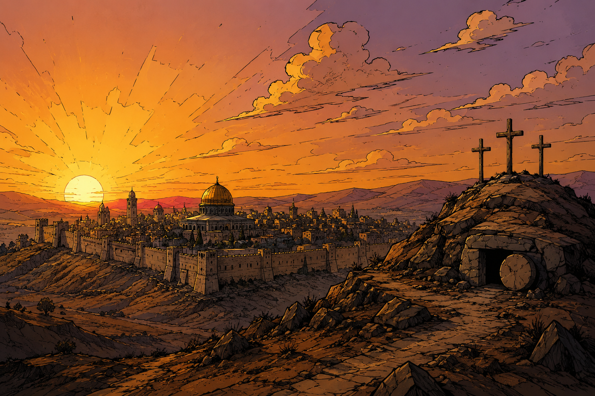

# Biblical Horizons for Omarchy

A warm, high-contrast dark theme for [Omarchy](https://omarchy.org), built around a coordinated collection of cinematic, hand-inked biblical landscapes.



## Biblical wallpaper collection

The theme includes a coordinated series of hand-inked, cinematic wallpapers:

1. [Creation](backgrounds/01-creation.png)
2. [The Flood](backgrounds/02-flood.png)
3. [The Nativity](backgrounds/03-nativity.png)
4. [The Crucifixion](backgrounds/04-crucifixion.png)
5. [David and Goliath](backgrounds/05-david-and-goliath.png)
6. [Revelation and the New Jerusalem](backgrounds/06-revelation.png)
7. [Jerusalem Sunset](backgrounds/jerusalem-sunset.png)

Cycle through them from Omarchy's background picker or run:

```bash
omarchy theme bg next
```

## Palette

- Deep umber backgrounds
- Sunset-orange accents
- Warm parchment foreground text
- Terracotta and mauve supporting colours
- Complementary ANSI colours chosen for terminal readability
- 11.99:1 foreground-to-background contrast

## Install

```bash
omarchy theme install https://github.com/thenailedone/omarchy-biblical-horizons-theme.git
```

The installer applies the theme automatically. You can select it again later as **Biblical Horizons** from Omarchy's theme switcher or with:

```bash
omarchy theme set biblical-horizons
```

## Update

```bash
omarchy theme update
```

## Remove

```bash
omarchy theme remove biblical-horizons
```

## Contents

- `colors.toml` defines the semantic and ANSI palette. Omarchy generates its application-specific theme files from it.
- `backgrounds/` contains the coordinated biblical wallpaper collection.

## License

The theme configuration and bundled artwork are available under the [MIT License](LICENSE).
