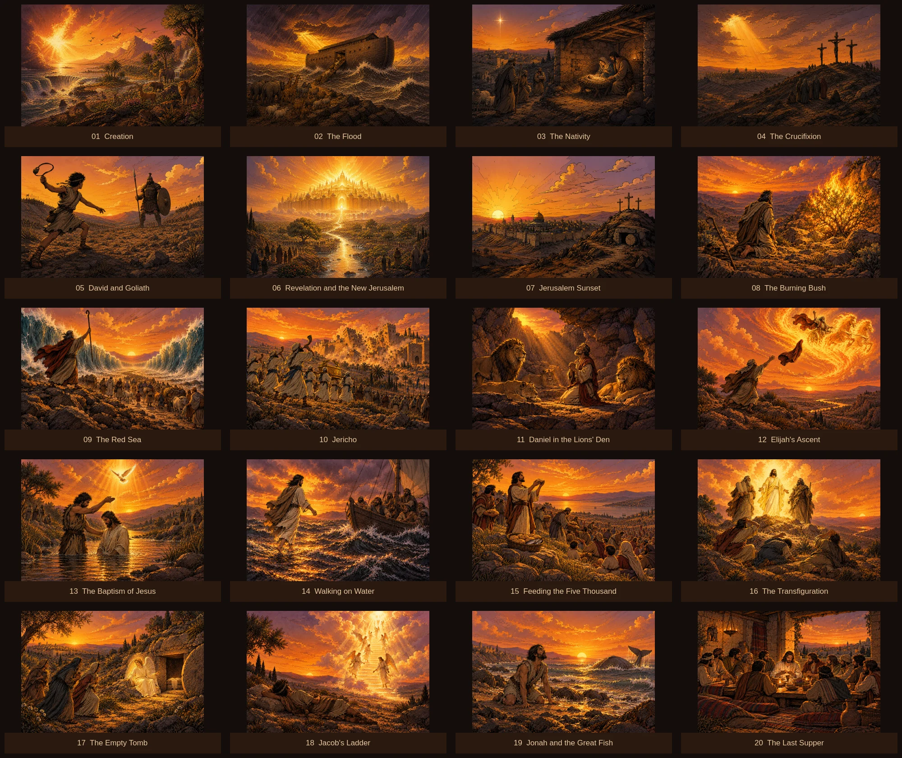
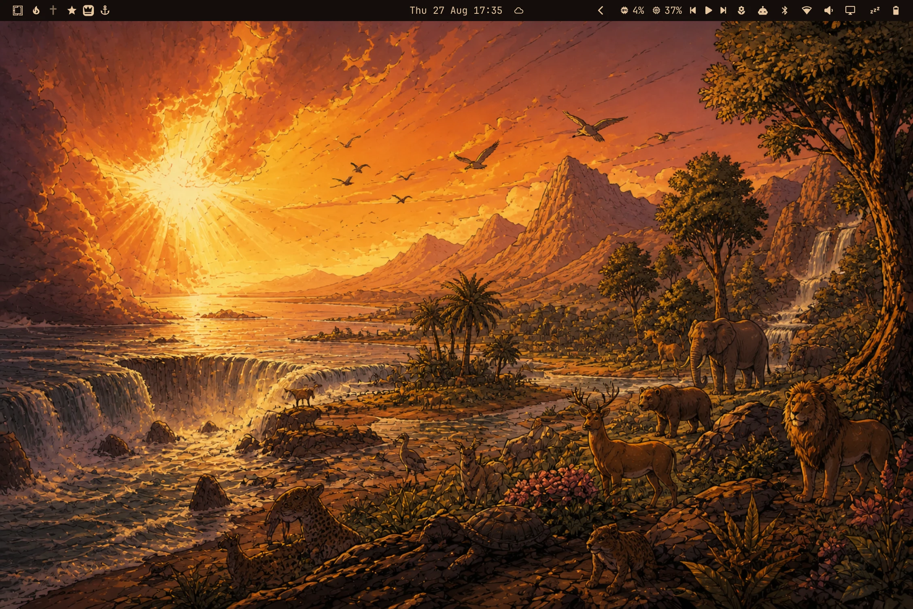
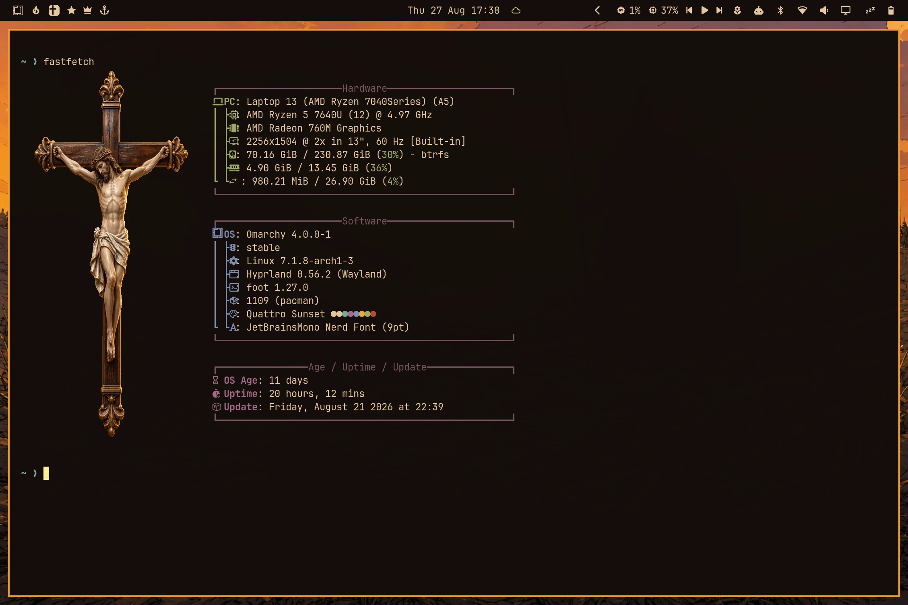
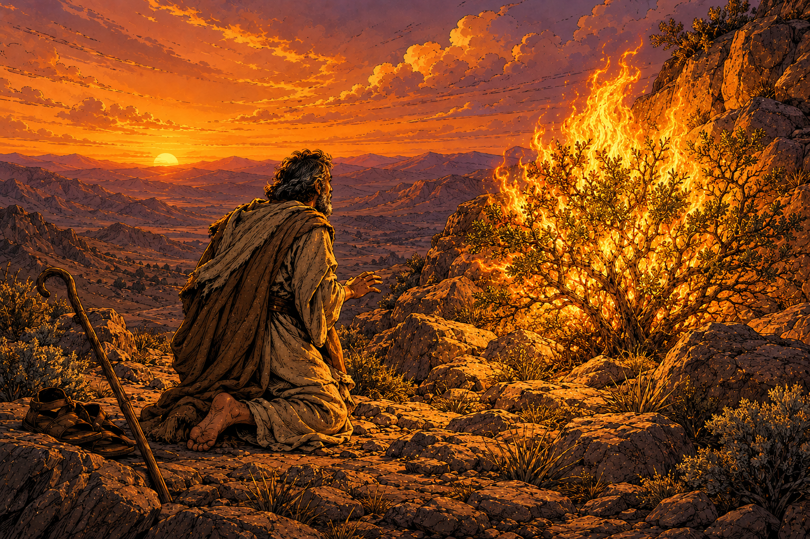
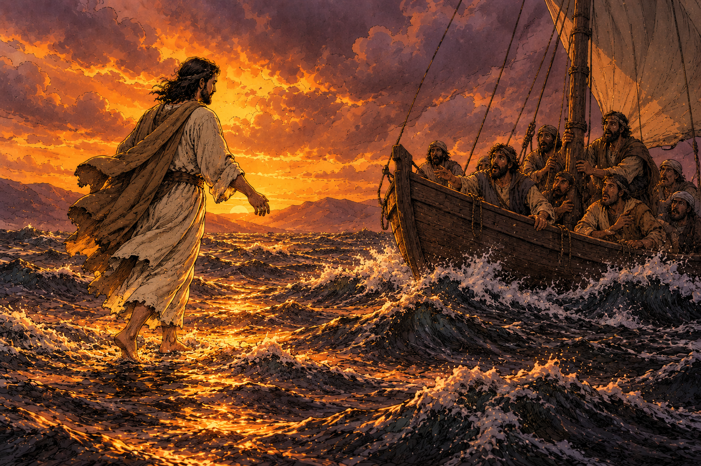
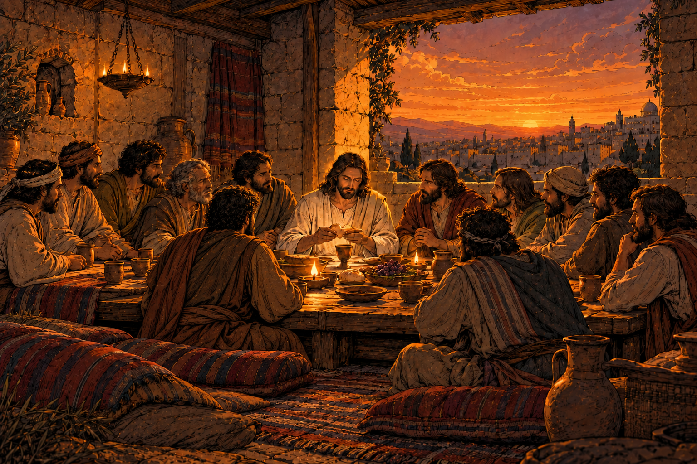

# Quattro Sunset for Omarchy

A warm, high-contrast dark theme for [Omarchy](https://omarchy.org), with **20 coordinated biblical wallpapers**, sunset-orange accents, deep umber backgrounds, and warm parchment text.

## Wallpaper gallery



The gallery shows the original artwork scaled to fit each tile. Full-resolution PNGs are included in `backgrounds/`; click a title below to view or download one.

## Desktop and terminal screenshots





These existing screenshots show the theme's desktop appearance and terminal palette. The wallpaper gallery above includes the expanded collection.

## Biblical wallpaper collection

| # | Wallpaper | # | Wallpaper |
| --- | --- | --- | --- |
| 1 | [Creation](backgrounds/01-creation.png) | 11 | [Daniel in the Lions' Den](backgrounds/11-daniel-lions.png) |
| 2 | [The Flood](backgrounds/02-flood.png) | 12 | [Elijah's Ascent](backgrounds/12-elijah-ascent.png) |
| 3 | [The Nativity](backgrounds/03-nativity.png) | 13 | [The Baptism of Jesus](backgrounds/13-baptism-jesus.png) |
| 4 | [The Crucifixion](backgrounds/04-crucifixion.png) | 14 | [Walking on Water](backgrounds/14-walking-on-water.png) |
| 5 | [David and Goliath](backgrounds/05-david-and-goliath.png) | 15 | [Feeding the Five Thousand](backgrounds/15-feeding-five-thousand.png) |
| 6 | [Revelation and the New Jerusalem](backgrounds/06-revelation.png) | 16 | [The Transfiguration](backgrounds/16-transfiguration.png) |
| 7 | [Jerusalem Sunset](backgrounds/jerusalem-sunset.png) | 17 | [The Empty Tomb](backgrounds/17-empty-tomb.png) |
| 8 | [The Burning Bush](backgrounds/08-burning-bush.png) | 18 | [Jacob's Ladder](backgrounds/18-jacobs-ladder.png) |
| 9 | [The Red Sea](backgrounds/09-red-sea.png) | 19 | [Jonah and the Great Fish](backgrounds/19-jonah-great-fish.png) |
| 10 | [Jericho](backgrounds/10-jericho.png) | 20 | [The Last Supper](backgrounds/20-last-supper.png) |

### More wallpaper previews







The original filenames are preserved, including `jerusalem-sunset.png`. Omarchy's next-background command follows filename order, so Jerusalem Sunset appears after the numbered wallpapers.

## Install

```bash
omarchy theme install https://github.com/sthuizen/omarchy-quattro-sunset-theme.git
```

The installer applies the theme automatically. To select it again:

```bash
omarchy theme set quattro-sunset
```

Use Omarchy's background picker to select a wallpaper, or cycle with:

```bash
omarchy theme bg next
```

## Update an existing installation

```bash
omarchy theme update
omarchy theme set quattro-sunset
```

The update command pulls changes for user-installed Git themes. Reapplying Quattro Sunset stages its updated files, including the expanded wallpaper collection, into the active theme.

## Palette and compatibility

- Deep umber backgrounds and warm parchment foreground text
- Sunset-orange accents with terracotta and mauve supporting colours
- A semantic colour palette plus compatibility aliases for older tools
- Omarchy generates application-specific theme files from `colors.toml`
- Includes unlock artwork and its preview

This theme follows the Omarchy 4 theme layout described in the [official theme guide](https://omarchy.org/manual/making-your-own-theme/). It does not require custom terminal configurations or executable theme code.

## Remove

```bash
omarchy theme remove quattro-sunset
```

## Contents and verification

- `colors.toml` — semantic palette and compatibility aliases
- `backgrounds/` — all 20 full-resolution PNG wallpapers
- `wallpapers.json` — ordered titles, dimensions, and SHA-256 checksums
- `previews/wallpaper-gallery.webp` — labeled overview of the full collection
- `theme-preview.webp` and `fastfetch-preview.webp` — desktop and terminal screenshots
- `unlock.png` and `preview-unlock.png` — unlock artwork
- `CHANGELOG.md` — collection changes

Validate the wallpaper collection using Python 3:

```bash
python3 scripts/check-wallpapers.py
```

To rebuild the gallery, install ImageMagick and run:

```bash
python3 scripts/build-gallery.py
```

## License

The theme configuration and bundled artwork are available under the [MIT License](LICENSE).
